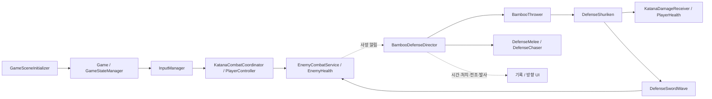

# BambooDefense 전환 및 리팩토링 계획

- 작성일: 2026-10-14
- 상태: 2026-10-14 S0~S7을 모두 완료했다(S7은 사용자가 승인한 범위: 문서, 근거 있는 잔여물·레거시 코드, 기존 모드 씬, 서드파티 미사용 에셋). 실제 입력·화면·사운드 확인 등 남은 확인은 [진행 문서](BambooDefense_refactoring_progress.md)를 따른다.
- 기준: [UNITY_REFACTOR_CONTEXT.md](../UNITY_REFACTOR_CONTEXT.md), [AGENTS.md](../../AGENTS.md), [기능명세 관리 규칙](../FEATURE_SPEC.md)
- 목표: 기존 `Assets/Scenes/Build` 게임을 `Assets/Scenes/Defense/BambooDefense.unity` 방식으로 전환하고, 기능을 수정할 때 읽어야 할 코드·문서와 함께 고쳐야 할 설정의 범위를 줄인다.
- 최초 산출물은 조사 계획서였다. 이후 사용자 요청에 따라 구현·에셋 이전·실행 검증을 진행한다. 아래 최초 조사 결과와 실제 완료 결과는 진행 문서에서 구분한다.
- 최초 조사 범위: 소스, 기능명세, 씬·프리팹 YAML, `.meta` GUID, 빌드 씬 목록의 정적 조사. 이후 실행한 컴파일·Play·에셋 이전 결과는 진행 문서에 따로 기록했다. 아래 최초 조사 설명 자체가 현재 실행 검증을 의미하지 않는다.
- 현재 브랜치: `refactoring`. 기준 커밋은 refs 직접 읽기로 `a7b646ca3ded556de516c0fd3f4466ee96490782`를 확인했으며, 미커밋 기준 사본 위치는 진행 문서에 기록했다. Git CLI와 커밋은 수행하지 않았다.

## 1. 현재 구조와 복잡성이 생긴 주요 원인

### 1.1 전환 전후의 게임 범위

| 구분 | 현재 확인된 구성 | 전환 계획의 기준 |
| --- | --- | --- |
| 기존 게임 씬 | `Build/Stage_1`, `Stage_2`, `Stage_3`, `BossBattle`, `TwinBossBattle` | 폐기 여부를 씬·전용 에셋·공용 코드별로 판단한다. |
| 현재 활성 빌드 목록 | `IntroScene`, `Stage_1`, `Stage_2`, `BossBattle` | 폴더에 존재하는 씬과 실제 빌드에 포함되는 씬을 구분한다. `Stage_3`, `TwinBossBattle`은 현재 목록에 없다. |
| 새 게임 씬 | `Defense/BambooDefense.unity`, 빌드 목록에는 비활성 등록 | 방어 게임의 구조를 정리한 뒤 정식 진입 경로와 빌드 구성을 전환한다. |
| 공용 기반 | 기존 Build 씬들과 BambooDefense가 `Player.prefab`, `GameSceneInitializer.prefab`, `UIManager.prefab`을 참조 | 방어 폴더만 수정해도 끝나는 독립 시스템으로 보지 않는다. 공용 프리팹 변경의 파급 범위를 기록한다. |
| 방어 전용 구성 | Director, 투척수, 수리검, 검기, 상시 추적, 자연 회복, 이동 경계, 기록·방향 UI | 이 기능부터 사람이 편집하기 쉽게 정리한다. |

게임 전환은 기능 변경이고, 방어 게임의 기존 결과를 유지하는 책임·데이터 정리는 리팩토링이다. 두 작업은 단계와 검증 기록을 구분한다. 밸런스 조정, 발견한 버그 수정, 성능 최적화도 각각 별도 변경 항목으로 남긴다.

### 1.2 현재 실행 진입점과 연결

1. `PlayerController.Awake`가 `Game`에 플레이어를 등록한다. `Game`은 입력·상태·감각·효과 매니저를 준비한다.
2. `GameSceneInitializer.Start → Initialize`가 플레이어의 `EnemyCombatService`, 씬의 `UIManager`, 입력·감각 연결을 준비하고 `GameStateManager.BeginPlaying`을 호출한다.
3. `BambooDefenseDirector.Update`는 `Playing`일 때 준비 시간을 줄이고, 생존 시간·플레이어 속도·투척수·근접 적 스폰을 갱신한다.
4. `BambooThrower.RunThrowCycle`은 대기 → 투척 예약 → 전조 → 발사 → 비행 종료 대기 → 위치 이동을 반복한다.
5. `DefenseShuriken`은 예측·유도·접촉을 처리한다. 방어는 `KatanaDamageReceiver`와 `KatanaCombatCoordinator`, 실제 HP는 `PlayerHealth`가 담당한다. 정확한 패링과 근접 회피는 `DefenseSwordWave`를 만든다.
6. 근접 적은 `DefenseMelee.prefab → Enemy_SingleMelee.prefab`의 프리팹 변형 관계를 사용한다. `DefenseChaser`가 기존 `EnemyController.HearNoise`를 이용해 추적을 유지한다.
7. `EnemyHealth.Died`를 Director가 받아 처치 수와 재사용 목록을 바꾼다. 기록 HUD와 방향 UI는 Director·수리검의 상태를 표시한다.
8. 플레이어 사망은 `PlayerController`의 행동 이벤트를 거쳐 `GameStateManager`의 게임오버가 된다. `GameOverUI`는 현재 씬 재시작을 요청한다.

### 1.3 우선 보존할 기준 동작과 설정

아래 값은 현재 씬·전용 프리팹의 저장값과 해당 코드에서 확인했다. 코드의 필드 초기값을 기존 에셋의 값으로 간주하지 않는다. 공용 Player와 적 기본 프리팹의 모든 override, 실제 애니메이션 결과는 구현 전 기준선 수집 대상이다.

| 기능 | 현재 기준과 변경 시점 | 보존 확인 방법 |
| --- | --- | --- |
| 준비·기록 | 준비 2초, 준비 종료 뒤 생존 시간 증가. `_kills`는 활성 목록에서 실제 사망한 적을 제거했을 때 증가 | 준비/생존 시간의 시작 프레임과 1회 사망당 처치 수를 전후 비교 |
| 투척수 증가 | 시작 3명, 생존 1분당 3명 증가, 최대 동시 생존 12명, 보충 간격 1.33초 | 초반과 증가 시점, 처치 후 보충을 비교 |
| 투척수 행동 | 대기 1.5~3초, 전조 0.6초, 노출 0.35초, 수리검 종료 뒤 이동 대기 0.6초, 피해 10 | 전조음·아이콘·발사·위치 이동의 순서를 비교 |
| 투척 제한 | 예약 + 비행 중 수리검 ≤ 3, 허가 간격 0.25초, 4m 이내 근접 공격 전조 중 새 투척 지연 | 예약 중 사망/비활성화와 비행 종료에서도 제한이 유지되는지 확인 |
| 근접 적 증가 | 준비 종료 후 약 5초부터 스폰. 시작 분당 15회, 이후 분당 스폰율 증가량 9. 최대 동시 생존 30명 | 시간 기준, 스폰 실패 시 다음 시각 처리, 동시 생존 상한 비교 |
| 근접 적 이동·종류 | 이동 4.8m/s, 가속도 12, 발걸음 간격 1.05m. 생존 90초 이후 돌진형 확률 0.4 | 이동·발소리·공격 종류와 재사용 시 종류 초기화 확인 |
| 수리검 | 속도 13m/s, 수명 5초, 판정 반경 0.3m, 예측 정확도 0.8, 예측 거리 상한 4m, 유도 45°/초, 4m 안에서 직진 | 정면/후면 피격, 가드, 패링, 회피 및 벽 접촉 비교 |
| 반격 검기 | 회피 감지 반경 3m. 검기 속도 40m/s, 거리 45m, 판정 반경 0.7m. 적별 1회 피해 | 일반 가드에는 검기가 없고 정확한 패링·근접 회피에는 생성되는지 확인. 투사체 패링의 자동 반격 돌진 제외 유지 |
| 자연 회복 | 실제 피해 후 5초 대기, 초당 3 HP. 막은 공격은 대기 시각을 갱신하지 않음 | 가드·패링·실제 피해 각각의 HP 및 회복 시작 시점 비교 |
| 이동 경계 | 현재 씬의 `DefenseArenaBoundary._radius = 23.6` | 이동·회피·자동 반격 돌진 중 경계 결과 비교 |
| 방향 UI | 반경 230px, 30m에서 0.8배 → 4m에서 3배, 종료 페이드 0.3초 | 시점 회전·거리 변화·화면비·전조 취소·게임오버 화면 비교 |
| 종료·재도전 | `GameStateManager`가 게임오버에서 시간 배율을 0으로 만들고, 재시작 시 현재 씬을 로드 | 시간·커서·입력·기록·적·수리검·이벤트 구독의 재시작 상태 비교 |

명세와 코드의 표현 차이도 먼저 기록한다. [대숲 방어 명세](../features/대숲_방어.md)의 “근접 적 5초부터”는 코드상 준비 시간 이후의 지연이다. “성능 상한 30”은 코드에서 분당 스폰율 제한이 아니라 동시 생존 수 제한이다. 실제 밸런스를 바꾸지 않고 기준 문장을 명확하게 해야 한다.

### 1.4 복잡성의 주요 원인

- 한 클래스에 서로 다른 변경 이유가 모여 있다. Director의 기록 표시용 상태와 NavMesh 스폰·재사용·투척 제한을 이해하려면 같은 파일을 넓게 읽어야 한다.
- 설정의 위치와 생성 방식이 섞여 있다. 씬 저장값, 프리팹 기본값·변형 override, 코드 초기값, 생성기 상수가 각각 존재한다.
- 공유 전투 코드는 규칙과 표현이 서로 조회·호출한다. 실제 전투 타이밍을 수정할 때 Coordinator, Driver, Visual의 처리 순서까지 따라가야 한다.
- 현재 동작과 과거 기록이 같은 문서에 누적되어 있다. 오래된 인수인계 문서에는 현재와 다른 입력·체력·애니메이션 연결 설명이 남아 있다.

## 2. 근거가 있는 문제 목록

우선순위는 **P0: 구현·삭제 전 확정**, **P1: 방어 게임의 반복 수정에 직접 영향**, **P2: 공용 구조와 후속 정리**로 나눈다. 수정 빈도는 최근 대숲 방어 변경 기록을 근거로 추정하며, 실제 팀의 편집 빈도는 미확인이다.

| ID / 우선순위 | 위치와 근거 | 문제·영향 | 제안 및 확인 수준 |
| --- | --- | --- | --- |
| R01 / P0 | `ProjectSettings/EditorBuildSettings.asset`, `Assets/Scripts/UI/IntroMenu.cs: LoadGameScene`, `IntroScene.unity: _gameSceneName` | BambooDefense는 비활성. Intro 씬에는 `Stage_1`, `SampleScene`을 지정한 IntroMenu가 각각 존재한다. 각 컴포넌트와 해당 GameObject의 로컬 활성값은 1이다. 실제 버튼 연결·부모 활성·실행 여부는 미확인 | 진입 경로를 하나로 확정한 뒤 전환. 두 컴포넌트가 실제 중복 실행한다고 단정하지 않고 버튼/계층을 확인 |
| R02 / P0 | `Assets/Resources/Defense/DefenseMelee.prefab: m_SourcePrefab`, `Assets/Editor/BambooDefenseSceneBuilder.cs: LoadOrCreateShurikenPrefab/LoadOrCreateMeleePrefab` | 근접 적은 `Enemy_SingleMelee` 변형이고 생성기는 `Shuriken3`와 기본 적 프리팹을 입력으로 쓴다. 방어 씬에 직접 보이지 않는 원본도 필요 | 런타임 의존과 제작 도구 의존을 함께 보존. 기존 적 폴더 전체 삭제 금지. 참조 확인됨 |
| R03 / P1 | `Assets/Scripts/Defense/BambooDefenseDirector.cs: UpdateThrowers, UpdateMelee, TryReserveThrow, TryFindMeleePosition, HandleMeleeDied` | 세션 기록·난이도·배치·NavMesh·재사용·투척 예산·속도 샘플링의 책임이 집중 | 세션 진행은 Director, 생성·배치는 Spawner, 투척 카운트는 작은 예산 객체로 정리. 책임 집중 확인, 분리 효과는 설계 제안 |
| R04 / P1 | `Assets/Scripts/Defense/BambooThrower.cs: _telegraphDuration`, `ShurikenDirectionIndicator.cs: _telegraphDuration`, `BambooDefenseDirector.ThrowTelegraphed(Vector3)` | 전조 시간을 두 Inspector에서 맞춰야 한다. 이벤트에는 위치만 있어 UI가 실제 전조 시간을 알 수 없다 | 투척수가 정한 전조 시간을 알림에 포함하고 UI는 읽기만 한다. 두 저장 위치 확인됨 |
| R05 / P1 | `Assets/Editor/BambooDefenseSceneBuilder.cs: Build, CreateArena, CreateDirector, LoadOrCreate*` | `NewScene`과 `SaveScene`으로 씬을 다시 만들어 씬 편집값을 잃을 수 있다. 기존 전용 프리팹은 그대로 반환하므로 생성기 수정이 이미 만들어진 프리팹에는 적용되지 않는다. NavMesh는 삭제 후 재생성 | 신규 생성과 기존 에셋 갱신을 구분하고 조정값의 원본을 지정. “모든 프리팹을 매번 덮어쓴다”는 상황은 아님. 분기 확인됨 |
| R06 / P1 | `DefenseArenaBoundary.cs: _radius = 11.6`, `BambooDefense.unity: _radius = 23.6`, 생성기 `PLAYER_RADIUS = 23.6` | 추가 컴포넌트의 초기값과 현재 씬 값이 다르다. 코드만 읽으면 실제 범위를 잘못 판단할 수 있다 | 현재 23.6을 이전 기준으로 기록. 신규 생성 기본값과 런타임 설정의 관계 명시. 현재 씬이 잘못 동작한다는 의미는 아님 |
| R07 / P1 | `Assets/Scripts/Defense/DefenseRecordHud.cs: Awake`, `ShurikenDirectionIndicator.cs: Awake/CreateGraphic` | Canvas·텍스트·마커를 실행 시 생성하여 편집 모드에서 배치·참조를 확인하기 어렵다. CanvasScaler 구성도 반복 | 방어 HUD 프리팹과 연결된 표시 컴포넌트로 이전. 현재 정렬·크기·마커 재사용 정책 보존. 생성 경로 확인됨 |
| R08 / P1 | `BambooThrower.OnDisable/CancelReservation`, `DefenseShuriken.Release/OnDisable`, Director의 예약·비행 카운트, `EnemyHealth.TakeDamage/OnEnable` | 예약 취소·비행 종료·사망·비활성화에 걸친 수명이 여러 객체에 분산. `EnemyHealth`는 사망 알림 후 비활성화하고 재활성화 때 HP를 복구 | 상태 전이와 해제 책임 명시. 카운트 누수나 중복 피해가 실제 발생하는지는 미확인 |
| R09 / P2 | `Assets/Scripts/Player/KatanaV2/KatanaCombatCoordinator.cs: GetChainStart/GetAttackElapsed`, `Player/Testing/PlayerActionDriver.cs: Update/GetPresentationTiming/UsesOpeningTimingForSecondAttack`, `KatanaWeaponVisual.cs: TryStartFirstAttackFollowup 호출` | Coordinator↔Driver 조회, Driver→Visual 조회, Visual→Coordinator 후속타 요청이 존재한다. 공격 종류별 시간 선택도 여러 메서드에 반복 | 계산 규칙과 진행 시계의 원본을 명시하고 표현의 관측 결과를 규칙 담당자에게 전달. 상호 참조는 확인됨. 무조건 FSM 프레임워크로 교체하지 않음 |
| R10 / P2 | `Assets/Scripts/GameManagers/GameStateManager.cs: RequestGameOver/RestoreTimeAndCursor`, `Assets/Scripts/Player/PlayerMotor.cs: BeginDashSlowMotion/RestoreDashSlowMotion` | 게임오버와 슬로모션이 각각 `Time.timeScale`을 저장·복구한다. TutorialGuide·SceneTransitionFade 등에도 쓰기 경로 존재 | 겹치는 시나리오의 원복 결과를 먼저 기록. 전역 배율 소유권 통합은 필요한 보존 동작이 확정된 뒤 수행. 현재 오류 여부 미확인 |
| R11 / P2 | `Assets/Scripts/GameManagers/GameSceneInitializer.cs: _legacyInput/_katanaInput`, `Assets/Scripts/Managers/InputManager.cs`의 실제 클래스 `PlayerInputController`, `PlayerContracts.cs`의 감지·맵 인터페이스 | 과거 입력 어댑터와 현재 입력 경로가 공존한다. 파일명만 보면 입력 담당자를 구분하기 어렵다. 조사한 `Assets/Scripts` 검색에서 일부 계약 구현체와 PlayerInputController 외부 호출은 찾지 못함 | 씬 GUID·Animation Event·문자열·다른 폴더까지 확인 후 유지/이전/삭제 결정. 미사용 확정 아님 |
| R12 / P2 | `KatanaDamageReceiver.cs: IsFrontBossCharge/IsFrontBossRanged`, `KatanaCombatCoordinator.cs: TryDefendIncoming`, `EnemyCombatService.cs`의 `BossController` 조회 | 방어 게임의 공용 전투 코드도 기존 보스 타입에 의존한다. 보스 스크립트 일괄 삭제 시 컴파일·판정에 영향 | 기존 모드 보존 결정 후 불필요 분기를 별도 정리. 일반적인 공격 정보로 바꿀 때는 보스 예외 규칙부터 기록 |
| R13 / P1 | `docs/features/플레이어_시스템_인수인계.md`, `docs/features/게임_씬_공통_구성.md`, `docs/FEATURE_SPEC.md` | 인수인계에 과거 프로젝트 절대 경로, 우클릭 미사용·체력 미연결 설명이 남아 있다. 현재 입력 코드와 KatanaDamageReceiver 상속·Player 프리팹 참조와 다르다. 기능 인덱스의 `발자국_시스템.md` 링크 대상은 없음 | 현재 명세를 앞에 두고 과거 기록 분리. 누락 링크의 올바른 목적지를 결정. 불일치 확인됨 |

추가 데이터 정리 후보: `DefenseThrower.prefab`에 `_aimDrop` 저장값이 남아 있지만 현재 `BambooThrower` 코드에는 해당 필드가 없고 `DefenseShuriken`이 조준 높이를 가진다. 실제 SerializedObject 상태를 확인한 뒤 대상 에셋만 정리한다. 전체 에셋 강제 재저장으로 확대하지 않는다.

## 3. 제안 구조

### 3.1 책임과 의존 방향

아래의 신규 이름은 가칭이다. 기존 MonoBehaviour의 GUID와 외부 연결을 먼저 유지하고 내부 책임부터 옮긴다. 독립 Inspector 설정·Unity 수명이 필요할 때만 컴포넌트를 추가한다.

| 담당 | 제안 책임 | 기존과의 차이 및 의존 규칙 |
| --- | --- | --- |
| `GameSceneInitializer` / `Game` | 공용 세션 연결과 종료 | 현재 기반 유지. 방어 구성의 시작 시점만 명확히 연결하며 방어 스폰 규칙은 넣지 않는다. |
| `GameStateManager` | 세션 상태, 게임오버·재시작 권한 | Director에 별도의 Playing/GameOver 상태 원본을 만들지 않는다. |
| `BambooDefenseDirector` | 방어 준비·생존 시간·처치 기록과 구성 요소 연결 | 스폰 및 투척 제한의 세부 처리 위임. 외부에는 읽기 상태와 필요한 명령·알림만 제공. 작은 속도 샘플링은 우선 유지한다. |
| `DefenseEnemySpawner` 가칭 | 적 배치, 시간별 생성 요청, 활성/대기 적 목록, 사망 구독 | Director의 `UpdateThrowers/UpdateMelee`와 생성·배치 책임을 옮긴다. 생존 시간을 전달받고 자체 복제 시계를 만들지 않는다. |
| `DefenseThrowBudget` 가칭 | 투척 예약·취소·비행 전환·비행 종료 카운트와 허가 간격 | 같은 Director 수명을 따르는 작은 일반 클래스로 시작한다. 전역 매니저·범용 예약 프레임워크를 추가하지 않는다. |
| `BambooThrower` | 한 투척수의 대기·전조·발사·이동 순서 | 자신의 예약 보유 여부를 관리하되 전체 카운트는 직접 쓰지 않는다. 전조 시간의 원본을 소유한다. |
| `DefenseShuriken` / `DefenseSwordWave` | 각 투사체의 이동·접촉·종료 | 현 역할을 유지한다. 수리검이 전체 스폰 관리 API를 알 필요가 없도록 필요한 대상·조준 데이터만 전달하는 방안을 검토한다. 이를 위해 새 전역 서비스는 만들지 않는다. |
| `PlayerHealth` / `EnemyHealth` | 각 HP와 사망 확정 | 자연 회복·검기·가드는 공개 명령을 사용한다. UI·Director가 HP를 직접 변경하지 않는다. |
| 기록 HUD / 방향 표시 | 상태 읽기와 시각 표현 | 방어 HUD 프리팹을 편집하고 표시 코드가 이를 참조한다. 전조 길이를 별도로 소유하지 않는다. |
| `PlayerController` | 행동 상태·ActionId·행동 수락·회복 | 기존 원본 유지. 모든 상태를 새 Coordinator 하나에 재집중하지 않는다. |
| `KatanaCombatCoordinator` | 가드·패링·반격·연계·납도 규칙 | 묶인 상태를 의미별로 정리하고 시간/표현 조회의 순환을 단계적으로 줄인다. |
| `PlayerActionDriver` | 행동 판정 시계·적중 구간·종료 통지 | 시간 선택 계산의 기준을 한곳으로 모은다. `Testing` 경로는 실제 런타임 역할에 맞게 이전하되 GUID·클래스 연결 보존. |
| `KatanaWeaponVisual` | Animator·검 시각 표현, 애니메이션 진행 결과 보고 | 게임 규칙을 직접 선택하는 부분을 줄인다. 클립 평가 뒤 후속타·피해 검사 순서는 먼저 보존한다. |

호출은 **입력 → 규칙 담당 → 실행 담당** 순서로 읽히게 한다. 결과 알림은 HUD·사운드·VFX처럼 복수 소비자가 있을 때 이벤트로 전달한다. 단일 호출을 이벤트 버스나 인터페이스로 우회하지 않는다. 현재 전투 경계인 `IDamageable`, `IPlayerCombatService`, `DamageContext`는 유지할 이유가 있다.

### 3.2 상태 소유권

| 상태 | 현재 원본 / 제안 원본 | 변경 권한·수명·초기화 |
| --- | --- | --- |
| 세션 진행 상태 | `GameStateManager.State` / 유지 | 시작·게임오버·재시작·종료 API만 변경. 씬 세션마다 초기화 |
| 준비·생존 시간·처치 수 | Director / 유지 | 준비·Playing 진행 및 확정된 적 사망만 반영. 재시작 때 새 세션 값 |
| 활성/대기 적 목록 | Director / Spawner | 생성·배치·사망·반납 경로만 변경. 씬 종료 시 사망 구독과 목록 정리 |
| 투척 예약·비행 수 | Director / ThrowBudget | 예약 성공, 취소, 발사, 종료가 각각 1회만 반영. Thrower의 `_reserved`는 개별 보유 표시이며 전체 카운트의 원본이 아님 |
| 적 HP·생존 여부 | `EnemyHealth` / 유지 | 피해·사망, OnEnable 재사용 초기화. 레지스트리 정리와 공격/무적/대상 상태의 별도 초기화도 확인 |
| 플레이어 HP | `PlayerHealth` / 유지 | `TakeDamage`, `Heal`만 변경. `DefenseHealthRegen`은 마지막 피해 시각과 회복 요청만 소유 |
| 행동·ActionId | `PlayerController` / 유지 | 행동 요청과 완료·취소·사망 처리만 변경. Driver가 보관하는 처리 중 ID는 비교용 캐시로 유지 |
| 패링 창·반격 기회·연계 예약·무기 상태 | Coordinator / 의미별 묶음으로 정리 | 시작·성공·종료·취소·피격·사망의 전이표를 작성. bool 수만으로 중복이라고 판단하지 않음 |
| 이동·회피·돌진 진행 | `PlayerMotor` / 유지 | 행동 명령에 따라 이동. 경기장 경계의 LateUpdate 보정 순서까지 포함해 검증 |
| 판정 경과 시간·적중/종료 송신 여부 | Driver / 유지 | 행동 ID가 바뀔 때 초기화. Update 예약과 LateUpdate 피해 검사의 순서 보존 |
| 방향 마커 모드·페이드 시간 | Indicator / 유지 | 화면 표현 전용 상태. 공격의 유효성이나 생존 기록을 결정하지 않음 |
| 전역 시간 배율 | 현재 GameStateManager·PlayerMotor 및 일부 씬 연출 | 현 쓰기 경로와 복구 순서를 명시. 통합 시 기존 GameStateManager를 권한 진입점으로 삼고 슬로모션·연출은 요청자로 변경하는 안을 검토하되, 기준 동작 확인 후 별도 범위로 확정 |
| 밸런스 설정 / 저장 데이터 | 씬·프리팹 설정 / 기존 설정 원본 | 런타임 HP·카운터를 공유 SO에 저장하지 않는다. 현재 방어 기록은 화면 표시이며 영구 저장 기능은 추가 요구로 분리 |

### 3.3 Inspector 편집 규칙과 값의 원본

이미 `[SerializeField]`, `Min`, `Range`, `Tooltip`을 쓰는 방어 코드가 있으므로 이를 활용한다. 핵심은 노출량을 늘리는 것보다 **어느 에셋의 값을 바꾸면 되는지와 그 값이 언제 적용되는지**를 명확히 하는 것이다.

| 수정하려는 내용 | 권장 편집 위치 | 원본·적용 규칙 |
| --- | --- | --- |
| 준비 시간, 적 증가량·상한·스폰 간격 | BambooDefense의 Director/Spawner Inspector | 역할별 Header, 초·m·분당·동시 생존 단위 표시. 값 이동 전 기존 씬 값을 복사 |
| 투척 대기·전조·피해·노출 | `Assets/Resources/Defense/DefenseThrower.prefab` | 전조 시간은 이곳 한 군데에서 편집. UI에 실행 이벤트로 전달 |
| 수리검 속도·예측·유도·회피 반격 거리 | `Assets/Resources/Defense/DefenseShuriken.prefab` | 모델 크기와 판정 반경을 구분. 기존 프리팹 수치를 이전 기준으로 사용 |
| 근접 적 이동·공격 | `DefenseMelee.prefab`의 변형 override | 기본 `Enemy_SingleMelee` 전체에 적용할 변경인지 방어 전용인지 구분 |
| 검기 이동·판정·표현 | `DefenseSwordWave.prefab` | 판정과 시각 크기의 차이를 설명. 상한·충돌 버퍼 변경은 별도 검증 |
| HP 회복 / 이동 경계 | `DefenseHealthRegen`, `DefenseArenaBoundary` | 각각 회복 규칙과 플레이어 경계의 담당자가 소유 |
| 기록·방향 UI 배치와 시각 값 | 방어 HUD 프리팹 | 위치·폰트·색·정렬은 편집 모드에서 확인. 게임 규칙 수치는 중복 보관하지 않음 |
| 플레이어 공격 시간·가드·회피 | 공용 Player 프리팹의 해당 담당 컴포넌트 | Driver는 판정 시간, Coordinator는 방어·연계 규칙, Motor는 이동. 타이밍과 클립 키 조정의 관계를 문서로 연결 |
| 공터·숲 반경·간격·시드 | 생성기용 설정 에셋 후보 | 생성기와 런타임 배치가 실제로 공유해야 하는 기하 설정만 SO 후보. 자동 재생성 없이 명시적 적용·베이크 시 변경 |

필드는 `[SerializeField] private`을 기본으로 하고 읽기 상태만 필요한 범위에 프로퍼티로 공개한다. 상수·static·역할별 필드 그룹, 메서드 주석과 접근 제한자 등은 AGENTS.md를 따른다. 이번에 손대는 범위부터 적용한다.

단일 컴포넌트 설정은 현재 필드 또는 작은 직렬화 묶음으로 충분하다. 복수 에셋이 함께 쓰거나 프리셋 전환이 필요한 경우만 SO를 도입한다. SO는 설정 원본이며 실행 중 상태를 쓰지 않는다. 공통 설정·프리팹 override·씬 override의 우선순위를 중첩시키는 추가 설정 체계는 피한다.

Inspector에는 단위, 허용 범위, 최소≤최대 같은 관계, 적용 시점(다음 스폰/다음 행동/씬 재시작/재생성)을 설명한다. 적용 시점을 통일하기 위해 기존 동작을 임의로 바꾸지 않는다. `OnValidate`는 값 검사에 한정하고 씬 생성·에셋 저장·자동 베이크를 수행하지 않게 한다.

## 4. 단계별 변경 계획

### 4.1 모든 단계에 적용할 이전·검증 규칙

- 구현 시작 시 `refactoring`의 기준 커밋 해시와 기존 미커밋 작업을 확인 가능한 방식으로 기록한다. 기준 씬·프리팹·`.meta`·프로젝트 설정의 복구 가능한 사본을 확보한다. 이 조사에서는 기준 커밋이나 브랜치를 생성하지 않는다.
- 현재 Git 지침을 따른다. Codex의 Git CLI와 기능별 자동 커밋은 `development/combat`에서만 허용된다. 다른 브랜치에서 체크포인트를 남길 때는 사용자가 관리하는 방식으로 수행한다. 자동 브랜치 변경·푸시는 계획에 포함하지 않는다.
- 기존 기능·타 작업과 충돌이 확인되면 AGENTS.md와 FEATURE_SPEC.md에 따라 해당 변경 전에 승인받는다. 기술적으로 독립적인 조사와 계획 작성은 계속 진행한다.
- 스크립트 이동 시 기존 `.meta`를 함께 이동한다. 클래스/namespace/assembly 변경은 별도 호환 검토를 거친다. 줄 수를 줄이기 위한 일괄 이름 변경·폴더 이동·asmdef 추가는 하지 않는다.
- 같은 컴포넌트의 필드 이름 변경에는 `FormerlySerializedAs` 적용을 검토한다. 필드 타입 변경, 직렬화 중첩 구조 변경, 다른 컴포넌트로의 이동은 별도 이전이 필요하다.
- 이전 전 `에셋 경로 + GUID + 컴포넌트/로컬 ID + 원래 필드 경로 + 값/참조 + override 여부`를 기록한다. 새 연결·값을 복사하고 저장·재로드 후 비교한 다음 기존 필드를 제거한다. 기본값으로 채워 넣는 방식으로 대체하지 않는다.
- Scene/Prefab Variant는 Unity의 에셋 편집 경로를 통해 이전하고 undo 또는 단계 전 사본으로 복구 가능하게 한다. `.unity`/`.prefab` YAML을 광범위한 문자열 치환으로 개조하지 않는다.
- UnityEvent 대상·메서드명, Animation Event 메서드명, Animator 상태·파라미터·클립 경로, Resources 문자열, SoundId/EffectId 직렬화 값, Input Action 연결도 계약으로 취급한다.
- 각 단계는 컴파일, 대상 에셋 재로드와 참조 확인, 관련 수동 플레이가 가능한 상태로 끝낸다. AGENTS.md의 테스트 코드 작성 금지에 따라 새 테스트 코드를 만들지 않는다. 검증 기록에는 실행 환경·절차·예상/실제 결과·미확인을 남긴다.
- 되돌릴 때는 해당 단계의 코드·직렬화 에셋·`.meta`·관련 명세를 함께 복원한다. 다른 작업자의 변경을 전체 리셋하거나 공유 프리팹 전체에 무조건 Revert하지 않는다.

### S0. 기준선과 보존 범위 확정 — P0

- **대상/선행:** 이 계획서, 대숲 방어·플레이어·공통 세션 명세, Build 5개 씬, BambooDefense, Intro, 공유 Player/UI/적 프리팹. 선행 단계 없음.
- **변경 전후:** 동작 변경 없이 현재 실행 진입점·Inspector 실제 값·프리팹 override·문자열 로드 경로·상태 변경 경로를 기록한다. 기존 모드의 보존 수준과 정식 메뉴 흐름을 확정한다.
- **보존/이전:** 1.3의 설정과 현재 전투 타이밍을 기준선으로 사용한다. 코드 기본값과 에셋 값이 다르면 양쪽을 기록한다. 비교용 플레이 영상/화면과 실제 입력 절차를 남긴다.
- **검증:** 기존 프로젝트의 컴파일 상태, 방어 씬 단독 진입, 준비→스폰→가드/패링/회피→피격→사망→재도전을 확인한다. 기존에 실패하는 항목은 리팩토링 회귀와 분리한다.
- **완료 조건:** 현재 플레이 성공 여부, 알려진 문제, 보호할 에셋, 미결정 사항의 담당과 상태가 명확하다. 기준 커밋 해시와 에셋 복구 지점을 기록한다.
- **되돌리기:** 실행 중 임시 조정한 설정은 저장하지 않거나 원래 값으로 복구한다. 조사 결과와 실제 자산 변경을 섞지 않는다.

### S1. Inspector 조정 위치와 생성기 책임 정리 — P1

- **대상/선행:** S0 이후. 방어 컴포넌트의 설정 필드, `BambooDefenseSceneBuilder.cs`, BambooDefense 씬, Defense 프리팹, NavMesh.
- **변경 전후:** 역할별 편집 위치를 3.3처럼 고정한다. 생성기는 신규 생성과 명시적 환경 갱신을 구분한다. 현재 프리팹 재사용 분기를 유지하면서 기존 씬 전체를 기본값으로 재구성하는 경로를 분리한다.
- **보존 조건:** 저장된 스폰·피해·경계 값과 프리팹 override 유지. 숫자 정리와 밸런스 조정을 한 변경으로 묶지 않는다. 대나무 배치와 NavMesh 결과도 초기 단계에서는 유지한다.
- **이전:** Header·Tooltip·단위 보완은 필드명 유지부터 시작한다. 설정 에셋 도입은 생성기/런타임이 공유할 기하 정보로 한정하고 기존 값 복사표를 만든다. NavMesh 재생성이 꼭 필요한 경우 참조 대상과 GUID 변화·재연결을 별도 기록한다.
- **검증:** Inspector에서 한 값을 변경해 저장·재로드하고 실제 적용 위치를 확인한다. 생성기 확인은 복제 작업본/별도 출력에서 수행하여 기존 씬의 수동 배치·값 보존 여부를 비교한다.
- **완료 조건:** 스폰 수, 투척 전조, 근접 속도, 경계 반경의 조정 위치와 적용 시점을 설명할 수 있고 변경이 소스 수정 없이 유지된다. 기존 에셋 재생성·갱신 정책이 명확하다.
- **되돌리기:** 새 설정 연결과 생성기 변경을 단계 전 사본으로 복원한다. NavMesh를 변경했다면 씬 참조까지 함께 복원한다.

### S2. Director의 스폰·투척 제한 책임 분리 — P1

- **대상/선행:** S1 이후. `BambooDefenseDirector`, `BambooThrower`, `DefenseShuriken`, 신규 Spawner/ThrowBudget 후보, Director의 씬 컴포넌트와 연결.
- **변경 전후:** Director는 준비·생존 기록과 구성 연결을 유지한다. Spawner가 배치·활성/대기 목록과 적 사망 구독을 소유하고, 확정된 처치만 Director에 알린다. ThrowBudget이 전체 예약/비행 카운트의 유일한 변경자가 된다.
- **보존 조건:** 스폰 목표 수와 간격 계산, 무작위 호출 순서, 위치 탐색 시도 수, 실패 시 처리, 근접 전조 우선순위, 사망 알림 후 비활성화 순서를 유지한다. 기존 투척수·근접 적의 씬 단위 재사용을 공용 PoolManager로 옮기지 않는다.
- **이전:** 이동한 설정·프리팹·UnitRoot 참조를 현재 씬에서 복사한다. 기존 Director 스크립트 GUID와 HUD의 읽기 연결을 유지하고, 새 담당자에게 위임이 완료된 후 중복 필드를 제거한다.
- **검증:** 준비, 최초 스폰, 증가, 상한, 스폰 위치 실패, 적 사망·재사용을 비교한다. 예약 성공→취소, 예약→비행, 비행→종료 각각에서 카운트가 한 번만 변하는지 확인한다.
- **완료 조건:** 스폰 조정은 스폰 담당과 그 설정에서 추적되고, 예약/비행 수 변경 위치가 한곳이다. HUD와 적이 Director의 내부 목록을 직접 수정하지 않는다.
- **되돌리기:** Director·관련 호출부·씬의 값과 컴포넌트 연결을 같은 단계 단위로 복원한다. 신규 컴포넌트를 제거하기 전에 원래 값을 복원한다.

### S3. 방어 세션의 시작·종료·재사용 계약 정리 — P1

- **대상/선행:** S2 이후. Director/Spawner/ThrowBudget, `BambooThrower.OnDisable`, `DefenseShuriken.Release/OnDisable`, `DefenseHealthRegen`, 방향 표시의 구독, `GameSceneInitializer` 연결부.
- **변경 전후:** 시작과 종료 진입점을 명시하고 코루틴·구독·예약·표시를 각각의 소유자가 정리한다. 씬 종료, 게임오버, 개별 적 비활성화가 같은 사건인지 구분한다.
- **보존 조건:** 투척수가 죽어도 이미 날아간 수리검은 기존 수명을 유지하는 `DetachShuriken` 동작, Released 1회 알림, 실제 피해만 회복 타이머를 갱신하는 규칙을 유지한다. 게임오버에서 기록을 보존한다.
- **이전:** 런타임 상태는 SO나 저장 데이터로 옮기지 않는다. 초기화 참조는 준비가 보장되는 지점에서 연결하고 정상적인 선택 기능/종료 중 참조 해제와 필수 연결 누락을 구분한다. 매 프레임 null 체크를 추가하는 방식으로 수명 계약을 대신하지 않는다.
- **검증:** 전조 중 투척수 사망, 발사 후 투척수 사망, 비행 중 씬 종료, 플레이어 사망, 재도전, 적 재사용, 컴포넌트 재활성화를 확인한다. 재활성화의 기존 지원 수준은 S0에서 확인하고, 새 지원이 필요하면 버그/기능 변경으로 분리한다.
- **완료 조건:** 각 자원의 생성·등록·해제 주체가 문서와 코드에서 일치한다. 종료 후 예약·구독이 다음 세션으로 넘어가지 않고 1회 피해·1회 처치 조건이 유지된다.
- **되돌리기:** 초기화·종료 코드와 참조를 단계 전 상태로 복원한다. 런타임 확인 후 씬을 다시 로드해 임시 상태를 제거한다.

### S4. HUD를 편집 가능한 에셋으로 이전 — P1

- **대상/선행:** S1~S3 이후. `DefenseRecordHud`, `ShurikenDirectionIndicator`, `DefenseDirectionMarker`, `BambooThrower`의 전조 알림, 신규 방어 HUD 프리팹, BambooDefense와 생성기 연결.
- **변경 전후:** Canvas·텍스트·마커의 기본 배치를 에셋으로 옮긴다. 표시 코드는 참조된 UI를 갱신한다. 전조 이벤트가 실제 전조 길이를 전달하여 UI의 중복 설정을 없앤다.
- **보존 조건:** 현재 기준 해상도 1920×1080, sorting order 3, 아이콘 크기 곡선·회전·알파·페이드, 마커 상한과 표시 생략 정책, 게임오버 뒤 기록을 유지한다. 공통 UIManager의 전체 구조를 다시 만들지 않는다.
- **이전:** 현재 Awake/CreateGraphic이 생성하는 RectTransform·CanvasScaler·폰트·색·raycastTarget 값을 프리팹에 복사한다. 마커 풀은 전용 구조를 유지한다. 전조 취소 표시의 의미를 추가한다면 별도 동작 변경으로 기록한다.
- **검증:** 편집 모드의 프리뷰와 Play 결과, 앞/뒤/옆 방향, 근거리/원거리, 전조·비행·종료, 마커 소진, 서로 다른 화면비, 재도전 뒤 Canvas/구독 중복을 확인한다.
- **완료 조건:** 기록과 방향 표시의 외형을 코드 없이 편집할 수 있다. 전조 시간은 한 번만 입력하며, UI가 게임 기록·판정을 변경하지 않는다.
- **되돌리기:** 이전 표시 코드와 씬 연결을 함께 복원하고 신규 HUD 인스턴스를 제거한다. 두 생성 경로가 동시에 실행되지 않게 한다.

### S5. 공유 플레이어 전투의 변경 범위 축소 — P2, 위험 높음

- **대상/선행:** S0 전투 기준선과 S2~S4 안정화 이후. `PlayerController`, `PlayerMotor`, `KatanaCombatCoordinator`, `PlayerActionDriver`, `KatanaWeaponVisual`, `PlayerAnimationEventRelay`, Player 프리팹·연결된 Animator/Clip.
- **변경 전후:** 먼저 Driver의 공격 종류별 시간 선택 중복을 한 계산 경로로 모은다. 이후 연계 예약·방어 창·납도 진행의 상태와 변경 메서드를 의미별로 정리한다. 표현은 클립 진행 결과를 알리고, 행동 시작·수락은 규칙 담당자가 결정하게 한다.
- **작업 크기:** Driver 계산 정리, 런타임 파일 위치 정리, 연계 상태 정리, 표현 호출 정리를 각각 컴파일·수동 확인 가능한 작은 작업으로 수행한다. PlayerMotor 전체 재작성과 범용 FSM·DI 도입을 함께 진행하지 않는다.
- **보존 조건:** ActionId, 입력 수락/거절 시점, 연계 예약창, 가드 시작 후 패링창, 자동 반격 지연, 적중/종료 이벤트, HP 차감 순서, Animator 평가 이후 LateUpdate 베기 검사, 회복 중 이동 허용 규칙을 보존한다. Driver와 Relay가 함께 존재한다는 이유만으로 중복 실행이라고 단정하지 않는다.
- **이전:** `PlayerActionDriver`를 런타임 위치로 옮길 경우 `.meta`와 클래스명을 보존한다. 설정 이동은 Player 기본 프리팹뿐 아니라 유지 대상 모든 씬·변형 override에 적용한다. Animation Event·UnityEvent 메서드명은 호환 창구를 유지한 뒤 실제 사용처 확인 후 정리한다.
- **검증:** 일반 1·2타, 조기/경계/늦은 후속 입력, 가드 시작·해제, 정확한/일반/후방 방어, 근접 자동 반격, 수리검 반격 제외, 회피 검기, 피격 중 취소, 사망 직전 공격, 재도전을 확인한다. 기존 모드를 보존한다면 대표 Stage와 Boss에서도 공유 변경을 확인한다.
- **완료 조건:** 공격 시간을 바꾸는 위치, 행동의 원본 상태, 애니메이션이 결과에 영향을 주는 경계를 설명할 수 있다. 효과음·시각 효과를 바꾸기 위해 피해 규칙을 수정할 필요가 줄어든다. 삭제한 호환 경로에는 호출·에셋 연결 확인 근거가 있다.
- **되돌리기:** 해당 작은 작업의 코드·Player 프리팹·override·애니메이션 연결을 함께 복원한다. 시간 배율 통합이나 발견한 버그 수정은 이 단계의 보존 검증에 섞지 않는다.

### S6. BambooDefense 정식 진입 및 빌드 전환 — 기능 변경

- **대상/선행:** S0의 제품 흐름 결정, S1~S4 완료와 공유 코드 변경 검증 이후. `IntroScene`, `IntroMenu`, 빌드 씬 설정과 사용 중인 Build Profile, `GameStateManager.Restart`, 씬 전환 관련 연결.
- **변경 전후:** 시작 버튼의 실제 수신자를 확인해 BambooDefense로 연결한다. 새 씬을 빌드에서 활성화하고 기존 스테이지 순회 경로를 정식 플레이 경로에서 제외한다. 기존 씬 자산의 삭제는 S7에서 판단한다.
- **보존 조건:** 메뉴 볼륨 설정, 키보드/마우스·패드 입력, 커서·페이드, 게임오버 재도전, 감각·사운드 기반 피드백을 유지한다. 무한 생존 게임에 엔딩·영구 기록 저장·메뉴 복귀를 자동 추가하지 않는다.
- **이전:** 씬 이름과 인덱스 사용처를 함께 조사한다. `NextSceneTrigger._nextSceneBuildIndex`와 `BossSceneExit`의 다음 인덱스 전환은 기존 모드 보존 여부에 맞게 처리한다. Intro의 두 `_gameSceneName` 값을 단순 전체 치환하지 않는다.
- **검증:** 선택한 대상 플랫폼에서 빌드 시작→메뉴 시작→준비→전투→게임오버→재도전을 수행한다. Editor의 `LoadSceneInPlayMode` 성공과 실제 빌드의 씬 로드 성공을 구분한다.
- **완료 조건:** 실행 빌드가 확정된 새 경로로 시작하고 현재 씬 재도전이 가능하다. 제거한 스테이지 인덱스에 의존하는 활성 경로가 없다.
- **되돌리기:** Intro 연결, Build Settings/Profile과 씬 전환 설정을 함께 이전 기준으로 복원한다. S7 전까지 기존 씬을 복구 경로로 유지한다.

### S7. 에셋·레거시 코드 정리 — 전환 후, 후보별 판단

- **대상/선행:** S6 빌드 흐름 확인 이후. 기존 Build·Map·보스/튜토리얼 전용 자산, 미사용 입력/호환 코드 후보, 방어 씬의 불필요 연결 후보. 삭제 확정 목록은 아직 없다.
- **변경 전후:** 남길 게임·도구·문서에서 필요한 자산을 기준으로 사용 범위를 좁힌다. 씬에서 사용하지 않는다는 사실과 프로젝트에서 삭제 가능하다는 판단을 구분한다.
- **이전:** 후보마다 `경로/GUID → 런타임 사용처 → 제작 도구 사용처 → 공유/문자열 참조 → 처분 → 복구 위치`를 작성한다. Resources/라이브러리에서 해당 항목을 제거해야 하는 경우 참조 제거와 실물 삭제를 함께 계획한다.
- **검증:** 후보 묶음별 컴파일·에셋 재로드·핵심 플레이, 큰 묶음 종료 시 대상 빌드. Missing Script/Reference, 누락 셰이더·폰트·사운드·애니메이션·NavMesh를 확인한다. 기준선에 이미 있던 문제와 새로 발생한 문제를 구분한다.
- **완료 조건:** 삭제한 모든 파일에 근거와 복구 방법이 있고 보존 대상에 새 참조 손실이 없다. 파일 수 감소 자체를 완료 기준으로 삼지 않는다.
- **되돌리기:** 제거한 에셋과 `.meta`, 라이브러리 항목·경로 상수·코드 연결을 같은 묶음으로 복원한다.

에셋 조사 우선표:

| 분류 | 현재 대상 예 | 처리 원칙 |
| --- | --- | --- |
| 보호할 직접 의존 | Defense 프리팹/머티리얼, Player, UIManager, Initializer, `NavMesh-Arena` | 참조와 override 보존 |
| 보호할 상속·제작 의존 | `Enemy_SingleMelee`, 생성기가 읽는 `Shuriken3`, Player의 KatanaRig/PlayerWeaponRig 및 애니메이션 | 원본 삭제 전에 변형·생성기 경로 해결. 모델을 복제했다는 이유로 제작 입력까지 불필요하다고 보지 않음 |
| 보호할 동적 의존 | `ResourcePaths.Managers`, `ResourceManager`의 `Prefabs/` 경로 보완, `Sound/SoundLibrary`, 효과 라이브러리, `Resources/Effects/IntroTextSlice` | 코드 문자열과 등록 데이터를 함께 확인 |
| 보호할 코드 밖의 의존 | FMOD 이벤트·뱅크와 필요 시 FMODProject, URP Renderer/윤곽선 셰이더, 렌더링 레이어, TMP 폰트, Input Action, NavMesh Agent/Area | 씬 GUID 검색만으로 삭제 판단 불가. 패키지 내부·바이너리·설정 연결도 확인 |
| 기존 모드 전용 후보 | Build 스테이지, Boss/TwinBoss, 복도/문/튜토리얼/기존 NavMesh 및 배경 자산 | 보존 방침 확정과 역참조 조사 후 후보 목록 작성. 공용 코드의 BossController 의존 먼저 해결 |
| 과거 구현 후보 | 입력 어댑터, `Managers/InputManager.cs`의 PlayerInputController, 미사용 계약/디버그·테스트 이름의 파일 | 실제 GUID·코드·문자열 사용처 확인. `PlayerActionDriver`는 현재 Player가 참조하므로 삭제 대상 아님 |
| 서드파티·패키지 | `Assets/ThirdParty`, FMOD 플러그인, Packages | 큰 폴더라는 이유로 삭제하지 않음. 남는 모델·머티리얼·라이선스·셰이더 의존 확인 후 별도 판단 |

`Resources` 안에 보관용 에셋을 남기는 것으로 배포 정리를 완료하지 않는다. 보관이 필요하면 리소스 경로 및 에디터 사용처를 확인한 후 관리 위치를 정한다. 렌더러·폰트·FMOD 자산은 Build에서 직접 보이지 않아도 남아 있을 수 있다.

### 4.2 수동 회귀 확인 절차

새 테스트 코드는 추가하지 않는다. 아래 시나리오는 해당 책임을 변경한 단계에서 실행하고, 주요 단계 종료 시 정식 빌드 흐름으로 확인한다. 아직 실행한 항목은 없다.

| 시나리오 | 확인할 결과 |
| --- | --- |
| 씬 단독 실행 / Intro 진입 | 플레이어·입력·상태·UI 초기화가 각각 한 번 성립. 현재 설정의 준비 시간 뒤 스폰 |
| Inspector 값 저장 후 재실행 | 변경한 담당 값이 저장·재로드 후 유지되고 다른 에셋/생성기에서 되돌아가지 않음 |
| 준비 종료·생존 90초 전후·상한 도달 | 기존 스폰 산식·돌진형 등장 조건·동시 생존 상한 유지. 같은 무작위 조건 비교가 불가능하면 정확한 위치 일치와 규칙 검증을 구분 |
| 정면 일반 가드 / 정확한 패링 / 후방 피격 | HP·패링 결과·검기·자동 반격 여부가 기준과 같음 |
| 수리검 3m 안/밖의 회피, 벽 충돌 | 회피 검기 조건과 관통/충돌 대상 규칙 유지 |
| 실제 피해 후 회복, 막은 공격 후 회복 | 회복 지연·회복량·최대 HP 제한 유지 |
| 전조 중 사망, 발사 후 적 사망, 적 재사용 | 예약/비행 수가 중복 반영되지 않음. HP·공격 상태·추적 대상·돌진 종류가 올바르게 초기화 |
| 공격·슬로모션·비행 중 플레이어 사망 | 사망 이후 피해·새 전조·기록·시간 배율·사운드의 결과가 기준과 일치. 의도 불명확한 결과는 별도 버그/설계 결정으로 기록 |
| 재도전 반복 / 씬 재진입 / 해당 컴포넌트 재활성화 | 이전 세션 적·예약·표시·구독이 잔존하지 않음. 지원하지 않던 재활성화 경로는 기능 추가와 구분 |
| 키보드·마우스 / 패드 / 포커스 전환 | 유지 입력·가드·커서·메뉴 선택이 기준과 같고 중복 입력 경로가 없음 |
| 대상 플랫폼 빌드 | 메뉴 진입·사망·재도전과 사운드·폰트·윤곽선·NavMesh 정상. 제거한 에셋/씬 로드 오류 없음 |

### 4.3 추가로 포함할 것을 권장하는 항목

1. **생성기 재실행의 데이터 보존 계약 — 필수.** 현재 생성기가 씬을 새로 만드는 구조이므로 “재생성”, “환경만 갱신”, “기존 조정값 보존”의 의미를 확정한다. S1 완료 조건에 포함한다.
2. **전환 승인 기준과 복구 가능한 삭제 목록 — 필수.** 새 빌드가 동작하는 시점과 기존 콘텐츠를 제거하는 시점을 구분한다. GUID·삭제 이유·복구 위치를 S7 작업 기록에 남긴다.
3. **초기화·시간·취소 정책 — 필수 조사, 변경은 근거에 따라.** 슬로모션 중 게임오버, 전조 중 적 사망, 씬 언로드의 우선순위를 명확하게 한다. 현재 오류가 확인되면 보존형 리팩토링과 별도 수정으로 처리한다.
4. **사람이 직접 수행하는 수정 과제 — 인수 기준.** 다른 작업자가 코드 수정 없이 투척 빈도와 HUD 위치를 바꾸고, 자연 회복과 패링 시점의 담당 파일을 찾도록 한다. 막힌 탐색 경로를 개선한다. 소요 시간 절감률을 근거 없이 약속하지 않는다.
5. **장시간 생존의 비용 측정 — 조건부 후속 작업.** 상한에 근접한 적 수에서 CPU/GC, 물리 검사, NavMesh 경로 계산, 수리검·검기 Instantiate/Destroy와 검기 메시 생성 비용을 측정한다. 병목이 확인될 때만 풀링·메시 재사용·갱신 주기를 조정한다.
6. **데이터 식별자 보존 — 필수.** SoundId/EffectId 숫자, Animation Event 이름, Input Action·PlayerPrefs 키 등 코드 밖 계약의 변경표를 둔다. 볼륨 저장과 신규 생존 기록 저장을 구분한다.

## 5. 컨텍스트·문서 정리 계획

새 문서 수를 늘리기보다 기존 진입점과 기능명세를 정돈한다. 문서는 코드 전체 설명 대신 읽기 시작점, 의도, 상태 권한, 에셋 연결, 변경 시 확인할 항목을 안내한다.

| 문서 | 제안 역할과 수정 범위 |
| --- | --- |
| `AGENTS.md` | 공통 작업·Git·주석·검증 규칙의 원본 유지. 기능별 수치나 구현 과거 기록을 넣지 않음 |
| `docs/UNITY_REFACTOR_CONTEXT.md` | 조사·계획 수립 기준 유지. 현재 게임 아키텍처 문서로 사용하지 않음 |
| `docs/FEATURE_SPEC.md` | 프로젝트 문서 진입점으로 활용. 방어 게임부터 읽는 경로와 현재/기존 모드 구분을 간결하게 추가하고 깨진 링크 정리 |
| `docs/features/대숲_방어.md` | 현재 플레이 규칙, 진입점, 상태 소유자, 편집할 에셋, 종료·재사용 계약, 수동 확인 절차의 기준. 날짜별 과거 수치와 현재 수치 분리 |
| `docs/features/게임_씬_공통_구성.md` | 현재 초기화·종료·씬 UI 사전 배치 규칙을 맨 앞에 유지. 폐기한 동적 UI 설명을 현재 동작처럼 읽히지 않게 분리 |
| 플레이어·카타나·피격·패드 입력 명세 | 각 기능의 실제 계약을 담당. 공격 판정 시간, 방어 규칙, 입력 매핑을 여러 문서에 복제하지 않고 소유 문서로 링크 |
| `docs/features/플레이어_시스템_인수인계.md` | 현재 경로의 짧은 읽기 안내로 갱신하거나 현재 명세로 연결하는 안내로 축소. 과거 절대 경로·체력 미연결·우클릭 미지원 설명은 현재 절에서 제거 |
| 이 계획서 | 현재 작업 범위·순서·의사결정·완료 조건 관리. 실제 완료 시 근거를 남기며 계획을 구현 완료 사실로 바꾸어 쓰지 않음 |
| 과거 작업 기록 | 관련 명세에서 완료 이력만 필요할 때 별도 archive로 이동하고 현재 문서에서 링크. 다른 기능의 기록을 일괄 이동하지 않음 |

기능명세는 FEATURE_SPEC의 공통 양식을 유지하면서 `현재 동작`, `관련 코드와 읽기 순서`, `상태 소유자`, `연결/편집 위치`, `보존할 제약`, `검증 상태`를 짧게 적는다. Inspector의 모든 숫자를 여러 문서에 전사하지 않는다. 중요한 규칙의 값은 에셋 편집 위치와 함께 설명한다.

권장 읽기 경로는 다음과 같다.

1. `FEATURE_SPEC.md`에서 기능과 담당 문서를 선택한다.
2. 해당 기능명세에서 진입점·상태·에셋 연결을 확인한다.
3. 해당 코드와 연결 에셋만 조사한다.
4. 공유 계약을 바꿀 때만 관련 기능명세로 범위를 넓힌다.

문서 갱신은 S7 뒤로 미루지 않고 각 구현 단계의 완료 조건으로 수행한다. 현재 문서와 코드의 차이가 발견되면 확인된 구현, 의도 추정, 미확인을 구분한다. 누락된 `발자국_시스템.md`는 현재 발걸음·감각 명세와 역할을 대조해 올바른 링크 또는 필요한 명세 보완으로 해결한다.

## 6. 지금 유지할 구조와 리팩토링에서 제외할 항목

### 유지할 구조

- `Game`, `Managers`, `GameStateManager`의 기존 공용 진입점. 전면적인 싱글턴 제거·DI 도입의 필요성은 이번 조사로 입증되지 않았다.
- `PlayerHealth`가 HP를 소유하고 `KatanaDamageReceiver`가 방어를 연결하는 현재 경계. 상속 구조 변경은 별도 필요가 확인될 때 판단한다.
- `EnemyHealth`의 사망 알림·활성 대상 레지스트리와 씬 단위 적 재사용. 구조 정리 과정에서도 사망 통지와 비활성화 순서를 보존한다.
- `DefenseChaser`의 기존 적 추적 재사용, 기존 `EnemyController`·공격 패턴 기반. 방어 전용 AI 전체를 새로 만들지 않는다.
- `DefenseShuriken`·`DefenseSwordWave`의 독립적인 판정 규칙. 기존 EnemyProjectile과 닮았다는 이유로 범용 투사체 계층으로 합치지 않는다.
- 표현만 담당하는 HUD 상태, ActionId 비교용 캐시, 정상적인 선택 참조, 재컴파일·씬 수명에 필요한 복구 코드. 유지 이유를 확인한 뒤 제거를 판단한다.
- 기존 URP 윤곽선, 감각 표현, FMOD·사운드·이펙트 계약. 컴포넌트 이름이나 파일 길이로 성능 문제를 단정하지 않는다.

### 별도 기능·정책·최적화 작업으로 분리할 항목

- 무한 생존을 유한 웨이브로 변경, 난이도 곡선·피해·패링/회피 판정 변경.
- 스태미나 가드 제한, 신규 적·보스, 영구 최고 기록·세이브 데이터, 메뉴 복귀·엔딩 추가.
- 발견한 기존 버그를 의도 확인 없이 새 기준으로 고치는 작업.
- 계측 없이 하는 모든 투사체 풀링, 렌더링 교체, NavMesh/물리 검사 주기 변경.
- Unity/패키지 업그레이드, Addressables 전환, 전역 이벤트 버스, 범용 FSM/DI/새 저장 프레임워크.
- 프로젝트 전체 이름 변경·폴더 이동·포맷팅, 새 테스트 코드 작성, 무관한 기능명세 수정.

## 7. 확인하지 못한 사항과 사용자 판단이 필요한 질문

### 기술적으로 추가 확인할 사항

- 현재 Unity 컴파일 및 실제 Play 정상 여부. 기존 문서의 과거 성공 기록을 현재 검증 결과로 간주하지 않는다.
- Intro의 두 IntroMenu가 어느 버튼에 연결되어 실제 실행되는지, 부모 활성과 로드된 오브젝트 상태.
- 공유 Player 및 모든 유지 대상 씬의 유효 override, Animator/Animation Event와 Driver/Relay의 실제 호출 횟수·순서.
- 바이너리/모델 내장 자산, FMOD 이벤트·뱅크, Resources 등록, 렌더러 설정을 포함한 전체 의존 관계. 현재 조사로 삭제 가능 에셋을 확정하지 않았다.
- 비활성화·재활성화·Domain Reload 설정별 초기화 및 예약·구독 정리 결과.
- 슬로모션과 게임오버·페이드가 겹칠 때 시간 배율·입력·사운드 복구 결과.
- 현재 사용 중인 Build Profile, 대상 플랫폼, 성능 기준. 재사용·GC 최적화의 필요성은 계측 전 미확인이다.
- 기준 커밋 해시, 기존 작업자의 변경 범위, 전환 기준선의 복구 가능 상태.

### 사용자 결정 — 2026-10-14 권장안 승인

| 질문 | 계획상의 권장안 | 답변에 따라 달라지는 작업 |
| --- | --- | --- |
| 기존 Build 게임과 보스·튜토리얼은 전환 뒤에도 실행 가능해야 하는가, 참고 자료로만 보관할 것인가, 완전히 제거할 것인가? | 새 빌드 검증까지 유지하고 이후 확정 목록으로 정리 | 공유 전투 호환 유지 범위, 보스 타입 의존 정리, 씬·음원·배경 자산 삭제 범위 |
| 정식 게임 흐름은 `Intro → BambooDefense → 게임오버 → 재도전`으로 확정할 것인가? 메뉴 복귀나 기존 튜토리얼이 필요한가? | 현재 메뉴·재도전 기능을 활용하는 흐름부터 확정 | Intro 연결, 빌드 목록, 새 메뉴 기능 여부 |
| 생존 시간·처치 수는 현재처럼 세션 화면 표시만 필요한가, 최고 기록 저장이 필요한가? | 이번 구조 정리에서는 현재 화면 표시 유지 | 영구 저장 책임·키·데이터 이전 요구의 추가 여부 |
| 출시/검증 대상 플랫폼과 반드시 지원할 입력 장치는 무엇인가? | 현재 구현된 키보드·마우스와 패드 경로를 보존하고 목표 플랫폼 지정 | 실제 빌드·입력·화면비·성능 확인 범위 |

사용자는 위 권장안을 모두 승인했다. 기존 게임은 새 빌드 검증까지 보존하고 이후 근거가 확정된 목록만 정리한다. 정식 경로는 Intro → BambooDefense → 게임오버 → 재도전이며 기록은 세션 화면 표시를 유지한다. 현재 호스트와 프로젝트 환경에 맞춰 Windows Standalone 64비트를 검증 대상으로 삼고 키보드·마우스와 패드 연결을 보존한다. 실제 하드웨어 입력 확인 여부는 별도 기록한다.

### 중단·컨텍스트 소진 시 재개 규칙

1. [진행 문서](BambooDefense_refactoring_progress.md)의 현재 단계, 다음 행동, 검증 로그, 변경 파일을 먼저 읽는다.
2. AGENTS.md와 해당 기능명세를 확인하고 현재 파일을 읽은 뒤 이어서 수정한다. 초기 계획의 조사 결과를 최신 구현으로 간주하지 않는다.
3. 진행 문서에 완료 근거가 없는 단계는 완료 처리하지 않는다. 변경·검증·미확인·환경 차단을 구분한다.
4. 코드/에셋 변경 직후와 검증 직후에 진행 문서를 갱신한다. 복구 지점과 실행 중 작업도 남긴다.
5. 권장안 승인을 다시 묻지 않는다. 기존 승인 밖의 충돌이나 파괴적인 변경이 생긴 경우에만 구체적인 근거와 함께 확인한다.

최종 인수 기준은 핵심 기능의 수정 위치를 찾기 쉽고, 상태를 바꾸는 담당자가 명확하며, 기존 방어 동작·저장값·Unity 연결을 보존하고, 사람이 입력부터 결과까지의 실행 흐름을 설명할 수 있는 것이다.
